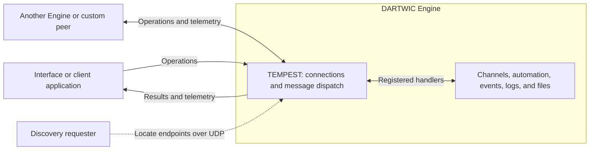

TEMPEST connects the Engine to Interfaces, applications, and other nodes. A client calls an Engine and subscribes to its data; a peer also has data and handlers that the Engine can address. Peers can link two DARTWIC Engines to share channels, events, logs, commands, and telemetry.

# Architecture

The TEMPEST server runs inside the Engine and provides the connection point for Interfaces, applications, and other nodes. It manages connections and delivers messages to the Engine's handlers, which read or change channels, tasks, events, and other resources.

The main parts are **clients**, which request actions and receive updates; **peers**, which exchange data and commands in both directions; and **discovery**, which helps find Engines to connect to.




TEMPEST is transport agnostic, and Client connections support ZeroMQ over TCP and HTTP/WebSocket. Both reach the same Engine operations and permissions. Peer connections use a separate peer abstraction: the built-in transport uses ZeroMQ/TCP, and plugins can supply transports for other links.

For example, a dashboard calls an operation to read a pressure channel, subscribes to its live updates, and receives later observations through telemetry. A peer can also expose its own measurements and handlers for the Engine to use.

# Operations and Telemetry

Operations and telemetry are how connected applications use the Engine. An **operation** asks for data or an action, such as reading events or writing a channel, and receives a response. **Telemetry** supplies ongoing updates, such as channel values shown in a live display.

A timeout leaves an operation's completion unknown; inspect state before retrying a command with side effects.

## Operation and Telemetry Messages

The client library builds the network messages for you. These examples use an already [connected Python client](../Clients/Python%20Client.md#connect). For example, read the Engine's active events:

```python
response = client.operation("argus/get-active-events", {"limit": 10, "offset": 0})
response.raise_for_error()
print(response.payload["events"])
```

To receive live channel values, attach a callback and keep the application running:

```python
import time

def receive(snapshot):
    if snapshot["exists"] and snapshot.get("available", True):
        print(snapshot["channel_data"]["value"])

stop = client.subscribe_channel("engine_dartwic_cpu_usage_percent", receive)
try:
    time.sleep(10)
finally:
    stop()
```

See [Using TEMPEST](Advanced/Using%20TEMPEST.md) for application examples, or [Custom Client](Advanced/Using%20TEMPEST.md#custom-client) for implementing the wire protocol yourself.

## Telemetry Delivery

Telemetry keeps live displays and connected applications updated. For channels, a **snapshot** contains the latest records in the client's subscribed set, including unchanged values and missing-channel status. The Engine sends `rapid/channels/snapshot` at 5 Hz, with a sequence number and destination client ID. Several writes can occur between snapshots; these updates do not contain every write or make task outputs atomic. Check source timestamps for freshness and recorded samples for intermediate values.

A slow WebSocket client can lose new observations when its delivery queue fills. Check drops in [Diagnostics](Diagnostics%20and%20Troubleshooting.md).

# Clients

A **client** is an application that connects to the TEMPEST server inside an Engine to read data, send commands, and receive live updates. The DARTWIC Interface is one client; your own Python, C++, or web application can be another. Each works through a registered session with its own permissions.

Use a [client library](../Clients/Overview.md) for application code, or [Using TEMPEST](Advanced/Using%20TEMPEST.md) for a raw connection.

## Registration and Permissions

Registration establishes who has connected and what they are allowed to do. The Engine checks protocol compatibility and credentials, then creates a **session** for that client. Administrators can request changes subject to resource authority; viewers receive permitted read-only access. The Interface also identifies operator connections for manual override.

## Session Recovery

A client must restore its session after it expires or the Engine restarts. It registers again and restores its subscriptions—the updates it asked to receive. During normal use, a small **heartbeat** operation keeps the session active.

# Peers

A **peer** connects another node, such as a second Engine or a C++ application, so both sides can share data and send commands to each other. Use peers when the Engine needs access to another system's measurements or supported actions.

For example, a `TEST_STAND` Engine can share channels, ARGUS events, and logs with `GROUND`, while `GROUND` sends permitted commands back.

The Engine Protocol provides the channel, event, and log routes; a TEMPEST-only peer exchanges custom operations and telemetry without those routes. The actual streams and commands depend on the connection's configuration and handlers.

Peer implementations consist of three parts: **Transport** moves messages, **Peer** manages identity and request/reply dispatch, and **EngineProtocol** handles channels, events, and logs. The TEMPEST-only option uses Peer and Transport without EngineProtocol. [Building a Custom Peer](../Plugins/Building%20a%20Custom%20Peer.md) covers transport and device-bridge internals.

## Connection Types

A connection type selects the protocol and transport used to reach a peer. Network Map includes the first two types below; Radio Link and F Prime illustrate types that plugins can supply.

| Connection type                     | Availability          | Example use                                                                                                         | Guide                                                                                                                                               |
| ----------------------------------- | --------------------- | ------------------------------------------------------------------------------------------------------------------- | --------------------------------------------------------------------------------------------------------------------------------------------------- |
| Engine Protocol Peer — TEMPEST TCP  | Built into the Engine | Link two DARTWIC Engines, or connect a C++ application that shares channels, events, and logs and handles commands. | [Connect in Network Map](../Interface/Network%20Map.md#connect-and-reconnect); [build a C++ peer](../Clients/C%2B%2B%20Engine%20Protocol%20Peer.md) |
| TEMPEST Protocol Peer — TEMPEST TCP | Built into the Engine | Connect an application that exchanges custom commands and telemetry without channel, event, or log integration.     | [Build a C++ TEMPEST peer](../Clients/C%2B%2B%20TEMPEST%20Protocol%20Peer.md)                                                                       |
| DARTWIC — Radio Link                | Plugin example        | Link two Engines over radios when the connection uses radio hardware instead of TCP.                                | [Build a custom transport](../Plugins/Building%20a%20Custom%20Peer.md#custom-transport)                                                             |
| F Prime — CCSDS                     | Plugin example        | Bring flight-computer telemetry into the Engine and send supported telecommands back over CCSDS.                    | [Build a protocol bridge](../Plugins/Building%20a%20Custom%20Peer.md#protocol-bridge)                                                               |

## Peer Connections

To link two Engines, give them distinct node names such as `GROUND` and `TEST_STAND`, and separate endpoints when running on one machine. The built-in connection targets the remote Engine's base port and credentials. Use [Network Map](../Interface/Network%20Map.md#connect-and-reconnect) to configure it; the [example workspace walkthroughs](https://github.com/kemptonburton/dartwic-example-workspace/tree/main/walkthroughs) also cover Engine-to-Engine and C++ peer setups.

Click on a connection in the Network Map to view telemetry and operation flow. You can also click the wire button on a node to configure a peer.


A remote channel appears as `TEST_STAND:tank_pressure`, keeping it distinct from a local `tank_pressure`. Use that qualified name in searches, schematic bindings, DCode references, and client requests. Writes are routed to the owning node and still obey its channel authority.

With `TEST_STAND` connected and publishing an existing pressure channel, a DCode body on `GROUND` can read the qualified name:

```dcode
remote_pressure = |TEST_STAND:tank_pressure|
```

This reads the latest locally cached observation.

## Remote Channel Freshness

A remote channel displays the latest data received from its owner, which may be older than the value currently at the source. Peer snapshots update the local copy and remove channels the owner deleted. Check both the connection and source timestamp to judge freshness:

| Observation | Interpretation |
| --- | --- |
| Snapshots arrive and the source timestamp advances | New source observations are reaching this Engine. |
| Snapshots arrive with the same source timestamp | Link activity continues; the sample itself may be old. |
| The peer is unavailable but a value remains | Cached data remains for inspection; it is not a current measurement. |

Built-in Engine peers send complete owned-channel and ARGUS board snapshots at 5 Hz, including unchanged records.

## Disconnection and Recovery

When a peer goes offline, its last known channels stay in RAPID and survive an Engine restart through the channel snapshot. Channels shows them as **Not Found**, and commands fail until reconnection. The retained numbers describe earlier observations.

If a peer is removed or renamed, its channels stay. To remove quickly, perform a **Channel Cleanup** to remove orphaned channels. Read more at [Node, Context, and Project Board](../Interface/Node,%20Context,%20and%20Project%20Board.md).

Use [Network Map](../Interface/Network%20Map.md) to inspect connection state, received snapshots, timestamps, and queue/drop evidence. A connection badge alone cannot establish that snapshots are arriving.

# Discovery

**Network discovery** helps the Interface find Engines you can connect to on the same local network, without entering their IP addresses first. The Interface sends a shared UDP query, and Engines reply with their names and connection details. The discovery destination is built into DARTWIC: **no DNS entry or static Engine IP is needed**. Selecting an Engine then starts the normal connection and login process.

## Discovery Configuration

Discovery is enabled by default and starts automatically with the Engine. **Engine settings > Enable network discovery** and **Network discovery port** (default `47600`) control it; changes require an Engine restart.


The Engine must listen on the network you want to use. Set its TEMPEST bind address to your computer's Ethernet/Wi-Fi IPv4 address for that adapter, or `0.0.0.0` for all available IPv4 adapters. `127.0.0.1` allows access only from the same computer. Discovery follows that setting automatically.

Firewalls, Wi-Fi isolation, and network boundaries such as routers, VLANs, or VPNs can block automatic discovery. You can still enter a reachable Engine's IP and connection port manually. A working ordinary connection does not guarantee discovery traffic can get through.

[Using TEMPEST](Advanced/Using%20TEMPEST.md#network-discovery) covers discovery payloads, connection endpoints, registration, operations, and telemetry.
