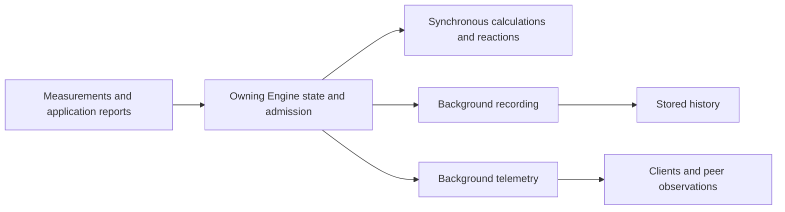

Recording saves what happened so you can review a test, compare measurements with events, or investigate a failure. Telemetry sends live updates to dashboards, clients, and other Engines.

DARTWIC records three kinds of data: channel measurements through **RAPID**, and events and text logs through **ARGUS**. **TEMPEST** delivers live updates; **retention** decides how long recordings remain available.

# Recording and Telemetry Delivery

When a sensor updates a channel, the Engine updates its live value and runs any synchronous calculations or reactions. Selected measurements then wait to be saved in the background, while telemetry sends live observations to connected viewers. Event history and logs are also saved in the background.



Control continues without waiting for disk or a dashboard. A live update can arrive before it is saved; a displayed command still needs equipment feedback to confirm it acted. See [Execution and Timing](Execution%20and%20Timing.md#asynchronous-execution).

# Recorded Data

A test can leave measurements, events, and written output to review together:

| Data | Service | Example |
| --- | --- | --- |
| Channel samples | RAPID | Temperature, pressure, or valve commands with measurement timestamps. |
| Events | ARGUS | A pressure warning, when it fired, repeated detections, and operator acknowledgements or prompt answers. |
| Logs | ARGUS | Startup messages, Builder output, or device errors, grouped by source and Engine run. |

# Live Telemetry

Telemetry is what lets an operator watch a running system without being on the Engine's computer. Different feeds supply different parts of that view:

| Feed | What it shows |
| --- | --- |
| Channel snapshots | Current records for subscribed channels, or channels selected for sharing with a peer. |
| Event-board snapshots | Events currently on the board, including their firing and operator status. |
| Log batches | New text from the selected streams. |
| Diagnostics | Engine load, task timing, recording progress, and connections. |

Channel and event-board snapshots are normally sent at 5 Hz. Query history when you need every recorded sensor sample. Peers share eligible locally owned channels, without forwarding imported channels as their own. See [Networking and Peers](Networking%20and%20Peers.md) for sharing and the [telemetry reference](Reference/TEMPEST/Telemetry/Overview.md) for message formats.

Receiving the same telemetry data again does not create extra history. New channel observations follow `record_mode`; metadata edits, such as units, update details without adding a measurement. An equal value with a new source timestamp qualifies for `every_value`.

Changed event observations update history without inventing detections. Logs use their source identity to recognize repeats; identical text with a new sequence is a new message.

## Why Complete Snapshots

These snapshots include every selected channel and current board event, even when nothing has changed. That can seem wasteful, but each update gives the viewer a complete picture of the latest reported Engine state without needing all the earlier updates.

For example, suppose a valve closes and the dashboard misses that update. The next complete snapshot still says it is closed, even if it never moves again. Sending only changes would need extra steps to detect the missed update and recover the correct display.

Complete snapshots help viewers recover from missed messages and reconnects.

This comes at the cost of bandwidth however, as more data needs to be sent over.

## Timestamps and Rates

A sensor task can write a channel 100 times per second while a dashboard receives five snapshots per second. Recording can keep every accepted value write when configured to do so; snapshots show the state collected for each update.

A channel's source timestamp comes from its latest value write, including a write of the same value. Receiving another telemetry snapshot does not update it. An unchanged timestamp can simply mean the channel has not been written again; telemetry can still be arriving normally.

To check incoming telemetry, open [Network Map](../Interface/Network%20Map.md) and look at **Telemetry RX** in Hz for clients or **DOWNLINK** in Mbps for peers. These show delivery activity separately from channel writes.


## Disconnected Nodes

If a remote Engine disconnects, observations already recorded on your Engine remain available. Check connection status and source timestamps before treating them as current. Actions that need the owner require reconnection.

# Channel Recording

Channel history shows changes and steady periods through individual writes and regular snapshots. These settings apply to channels; events and logs record separately.


## Recording Modes

Choose which channel writes to save with `record_mode`:

| Mode              | Write-triggered samples                                                  |
| ----------------- | ------------------------------------------------------------------------ |
| `on_value_change` | Writes that change the number. Steady readings can leave sparse history. |
| `every_value`     | Every accepted value write, including repeated equal measurements.       |
| `every_value_exclude_autorecord` | Every accepted value write, including repeated equal measurements, without periodic snapshots. |
| `never`           | None from writes; the value remains available live.                      |

Choose before the run: use `every_value_exclude_autorecord` when the history must contain only submitted measurements. Use `every_value` when you also want periodic snapshots of the cached value. Both retain repeated equal readings. The new mode requires Engine 2.1.0.

## Periodic Snapshots

By default, DARTWIC records the current values of its local channels once every second, even when their recording mode is `never`. Channels using `every_value_exclude_autorecord` are excluded. It does this by taking a periodic snapshot of the values held in memory.

This gives history a regular baseline even when values stay steady. Baseline continuity shows that the Engine captured cached state; it does not prove a sensor continued acquiring. While a channel exists and the baseline is enabled, unexpected gaps can point to Engine downtime or recording trouble. Check diagnostics, filters, and retention before deciding the cause; live telemetry delivery is separate.

Under **recording** in the Tasks / Modules channel view, use `engine_rapid_autorecord_enabled` to enable or disable the baseline and `engine_rapid_autorecord_interval_seconds` to change its interval. The interval is an expected cadence, not an exact deadline. A snapshot captures the value held in memory; the sensor may not have supplied a new reading.

Remote channels are skipped by this baseline. Their received observations follow the source's recording mode and do not reproduce its full acquisition history.

## Record Every Sample Without Periodic Snapshots

If you want your device to record exact samples and not be mixed with periodic snapshot samples, use `every_value_exclude_autorecord`. Every channel sample will be written, and the channel will not save periodic snapshots.

The **LabJack stream worker** enables this mode before acquisition and keeps it through connection attempts and reconnects, so interruptions leave acquisition gaps. Cleanup restores `on_value_change`, allowing idle snapshots again. This simplified C++ excerpt shows the SDK calls for a configured fixed `channel` and an acquired batch, `samples`:

```cpp
using namespace DARTWIC::API;

// Before acquisition: exclude periodic snapshots.
api->upsertChannelField(channel, ChannelField::RECORD_MODE,
    RecordMode::EveryValueExcludeAutorecord, ChannelStorage::Fixed);

// For each batch: submit (value, Unix-nanosecond timestamp) pairs.
api->upsertChannelValueBulk(channel, samples);

// Worker cleanup: restore idle recording after sample submission stops.
api->upsertChannelField(channel, ChannelField::RECORD_MODE,
    RecordMode::OnValueChange, ChannelStorage::Fixed);
```

LabJack calculates each sample's timestamp from the stream start, scan number, and scan rate. Its `upsertBulk` wrapper calls `upsertChannelValueBulk` to submit those samples together.

The bulk path queues the samples with their timestamps and updates live memory once with the final sample, without recording it twice. Three equal readings therefore produce three history samples, while live memory holds the third reading.

Live telemetry can omit intermediate samples; query or export history for the recorded stream. Limit exact-acquisition exports to the worker's run interval because idle history can contain snapshots. This mode does not guarantee lossless acquisition or storage; check [recording diagnostics](Diagnostics%20and%20Troubleshooting.md#rapid) for drops, errors, and queue pressure.

## Saved Channel State

The Engine restores its latest saved channel state from `channel_snapshot.json` after restart. This is separate from measurement history: restored values are not new readings, and remote values still need fresh observations after reconnect.

## Recording Capacity

Selected samples wait in memory while a background recorder saves them to disk. This waiting area is the **recording queue**. Its capacity determines how much data can wait during a burst of measurements or a storage slowdown.

Larger queues use more memory. They can absorb short bursts, but a disk that stays too slow will eventually fill them. Check [recording diagnostics](Diagnostics%20and%20Troubleshooting.md#rapid) before increasing capacity.

To change the RAPID queue limits, merge this into `recording.options` in workspace or project `settings.json`, then restart. These are the defaults, not a complete settings file:

```json
{
  "recording_queue": {
    "scalar_rows": 262144,
    "bulk_rows": 8388608,
    "bulk_bytes": 201326592,
    "bulk_blocks": 1024
  }
}
```

`scalar_rows` limits individual samples; the `bulk_*` limits cover batches. Use positive integers and check the limits after restart. ARGUS and prepared execution have separate buffers; these limits do not cap total Engine memory.

# Event and Log Recording

Events explain conditions and operator responses; logs preserve what software reported. ARGUS saves both as they happen, so you can compare them with measurements later.


## Events

If a temperature limit is crossed, event history shows when the warning fired, how often it was reported, and what operators did. Recording begins while active, before acknowledgement or resolution.

Repeated reports of a temperature warning are **detections** within one firing **occurrence**. History keeps counts and interval boundaries, rather than a row per repeat. Resolving the event keeps its history.

Remote snapshots can miss transitions; query the owning Engine for its archive. See [Events and Logs](Events%20and%20Logs.md#events) for firing and lifecycle rules.

## Logs

Logs preserve timestamped text and its source. A **stream** groups output such as Builder or a plugin; a **session** identifies an Engine run. ARGUS saves readable text and queryable records.

Forwarding preserves source, time, and sequence to recognize duplicates. An error log does not automatically create an event. See [Events and Logs](Events%20and%20Logs.md#logs) to produce messages or the [Interface Events and Logs Guide](../Interface/Events%20and%20Logs.md#recorded-logs) to browse them.

# Historical Queries

To review a run, open **Data → Databases**, choose **RAPID Channels**, **ARGUS Events**, or **ARGUS Logs**, then set a range and filters. This reads the connected Engine's recordings, including remote data saved here.


You can also view and export them all together in the [Telemetry Graphs](../Interface/Telemetry%20Graphs.md).


## Query Historical Samples

For application queries, see the [Python client](../Clients/Python%20Client.md) channel examples and the [Events](Reference/TEMPEST/Operations/Events.md) and [Logs](Reference/TEMPEST/Operations/Logs.md) query references.

## Preview versus Raw Data

A graph can reduce samples to fewer plotted points (**bucketing**); raw exports retain recorded samples. Events and logs load in pages. See the [data guide](../Interface/DataFrames%2C%20Databases%2C%20and%20Exporting%20Data.md) for browsing and exports.

# Recording and Delivery Loss

A missing dashboard update and a missing recording are different problems. The Engine can keep recording while delivery to a viewer fails, or keep showing live values while storage falls behind.

When recording queues fill, new recording work can be rejected and counted without undoing the live update. A slow log subscriber can likewise lose delivered messages while disk recording continues. [Diagnostics](Diagnostics%20and%20Troubleshooting.md#argus) separates these failures and shows backlog and progress.

Before treating an empty graph as data loss, check its time range, filters, and retention. During a heavy run, also check task timing: recording and delivery still use CPU even though they run in the background.

# DataFrames, Retention, and Deletion

A **dataframe** names a run's range and filters for later review. Starting/stopping marks that range without changing recording.

**Retention** removes old history automatically. Configure separate channel, event, and log age/size limits under **Settings → Engine → History and recording**. Projects can override workspace defaults; zero leaves a limit unrestricted. Saved frames do not protect recordings from cleanup.


Removing a frame keeps its recordings. Deleting recordings removes underlying local history and can affect several frames; review the preview first. Live channels and a remote Engine's archive remain separate. Disk space may be reclaimed later.

Recordings belong to the Engine instance. Copying a workspace alone does not copy its history; see [Configuration and Storage](Configuration%20and%20Storage.md#instance-data) for paths and backups.
