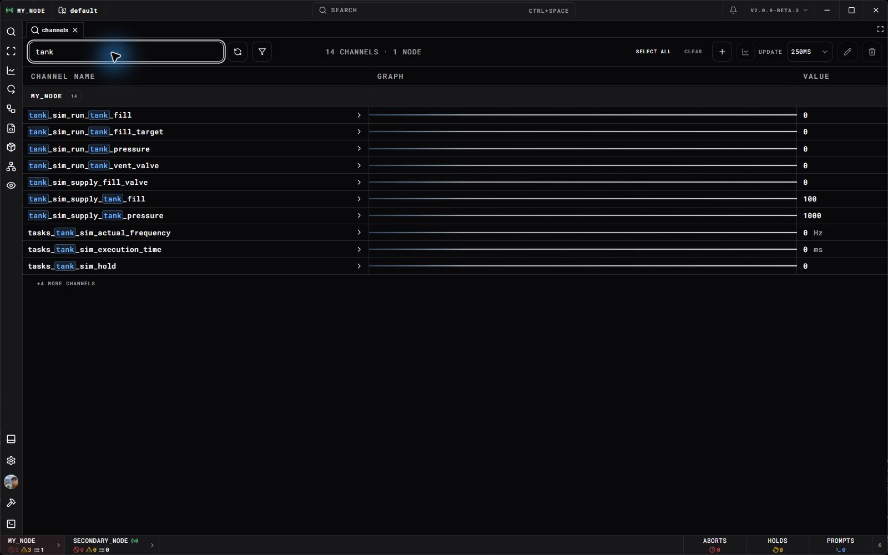

Start with an engine and a compatible Interface. If a teammate already runs the engine, ask for its address and connection details and skip to [Connect the interface](#connect-the-interface).

Public Engine/Interface downloads and license signup are still being prepared. The [Downloads page](/areas/dartwic/downloads) reports their availability. These steps apply when you have the matching packages or a development installation.

## Open a workspace

The [example workspace](Example%20Workspace.md) is a useful first project because it supplies a simulated device and working scripts. Keep its repository folders together; the actual workspace is the nested `example-workspace/` folder.

1. In **Settings → Interface**, choose **Add** to download the packaged engine and workspace into a destination folder. Both folder selections start blank in a fresh Interface installation and fill automatically after installation. They are read-only; use their folder buttons to select existing folders. **Add workspace** also offers **Download engine** when no engine is configured. Wait for installation to finish before adding another workspace.
2. Choose **Add workspace** on the landing page and select the workspace folder, not its `default/` project folder.
3. Select the project and local engine settings. If an existing engine instance matches this workspace, review the settings loaded from it. Enter a license key if needed for the project's capacity.
4. Choose **Add node** to save the setup. Open its **Start** console, review dependencies, and prepare the workspace while stopped.
5. Choose **Start engine**, then **Open workspace** when it is ready.

The engine runs the tasks and owns the recordings. The Interface can close and reconnect without stopping them. [Tracking a Project in GitHub](Tracking%20a%20Project%20in%20GitHub.md) explains the installation, instance, and workspace folders.

Desktop preferences, saved connections and local workspace registrations stay with each Interface installation in its `.dartwic/` folder. Separate extracted copies have separate settings; keep that folder when moving or updating an installation. The first launch with installation-local storage starts fresh rather than importing the old shared settings. Hosted Interface preferences still belong to the browser origin; its local workspace registry is stored beside the web host.

**Forget** removes a node's saved entry from this Interface. It leaves the engine running and preserves its instance configuration, workspace, recordings and installed files. A forgotten engine may still appear in network discovery, and its workspace can be added again later. Use **Stop engine** separately when you want to stop it.

## Launch an engine directly

You can also launch the executable from an extracted package's `engine/bin/` directory. Its default instance configuration is `engine/instances/default/config.json`. `DARTWIC_CONFIG_DIR` selects a different instance directory. Check the **Config directory** printed at startup before editing settings.

While the engine is stopped, configure the workspace path, active project, server address, base port, and administrator password there. The node name belongs in the workspace's `workspace.json`. Keep credentials and license files local to the instance. [Compatibility, Licensing, and Tiers](Compatibility%2C%20Licensing%2C%20and%20Tiers.md) covers capacity and activation.

For another computer to connect, use a reachable bind address and network access. With base port 7000, native operations use 7000, native telemetry uses 7001, and web transport uses 7002. [Using TEMPEST](../Engine/Using%20TEMPEST.md) explains these endpoints.

## Connect the interface

1. Launch the Desktop Interface or open your deployment's hosted Interface.
2. Select a discovered engine, or choose **New Connection** and enter its address and base port.
3. Enter the engine's administrator password and connect. If you have no saved username, enter one in the popup and choose **Continue**. For permitted read-only access, choose **Connect as viewer** instead.
4. Confirm the connected node and active project in the top bar.

A rejected password, unreachable engine, and incompatible version require different fixes. Read the connection error before changing settings. Viewer access must be enabled on the engine; a viewer cannot run the editing or command steps below.

## Find nearby engines

With Interface network discovery enabled, the login page looks for running engines automatically while visible, refreshing about every 15 seconds. Discovered engines show their workspace name, node name and connection endpoint. A local engine matching a discovered workspace appears once as **Local workspace · Discovered**; selecting it opens the workspace setup/adoption flow. Other **Discovered** rows fill the connection address and port; then enter the engine password or choose viewer access. Discovery does not send a password or connect automatically.

When enabled, TEMPEST answers a small UDP query on its configured discovery port (default **47600**), including when their normal connection port is customized. Discovery covers the Interface host's active IPv4 adapters and `127.0.0.1`; it does not scan address ranges or all ports. An engine bound only to localhost stays local. Multiple engines on the same computer can all appear.

Use **Settings > Interface > TEMPEST network discovery** to disable searches or choose discovery ports. Engine settings control whether an engine answers and which port it uses; changes there require an engine restart.

The desktop app runs discovery locally. A web deployment runs it on the web host, and its discovery endpoint requires a local browser connection to that host. IPv6-only engines, engines on routed networks, older engines without the responder, and networks that block multicast may need **New Connection** or a saved connection. Engine credentials and viewer restrictions still apply.

## Inspect a channel

Open **Channels**, search for a signal, and select its name. Engine diagnostics are available before installing a driver. In the example workspace, search for `rocket_sim` and check that `rocket_sim_sample_counter` advances.

Check the value, units, timestamp, and stale state. For an output, inspect its control policy and active controller too. A flat value can be a steady measurement; a disconnected source can also leave its last value visible.

Follow [DCode Getting Started](../DCode/Getting%20Started.md) to create a small clock task and calculation without hardware. Activate the file, start the task, inspect its outputs, then stop it. Saving a script or closing its tab does not stop active automation.

## View and record a run

Open an existing schematic to see the signals in context. [Schematics](../Interface/Schematics.md) covers editing and binding displays or controls.

Use [DataFrames](../Interface/DataFrames.md) to capture a named run, or [Recorded Data](../Interface/Recorded%20Data.md) to find history already on the engine. A frame selects data; recording policy determines which samples exist. [Telemetry Exporter](../Interface/Telemetry%20Exporter.md) compares a time range and exports CSV.

When finished, stop your demo tasks. Stop the engine through its local node controls if you also want the engine process to end.
