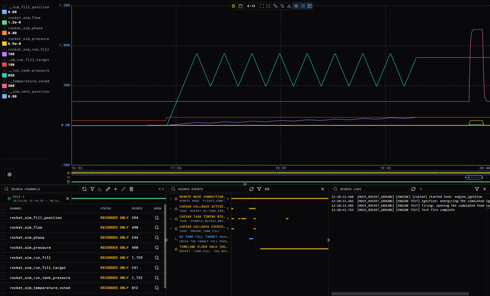
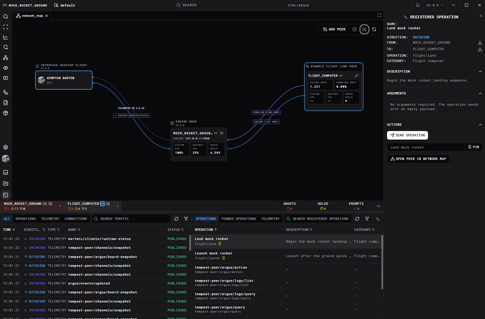

DARTWIC brings data acquisition, controls, and an operator interface together. You can connect sensors and equipment, write the logic that operates them, and build diagrams that show what is happening while you run a test.

It began with rocket testing, where changing a sensor or valve often meant changing several different tools and hardware, which takes a lot of time. The aim is to keep the useful parts of a control system together so the next person can understand and extend it without starting over, and providing the tools to iterate very quickly.

# Engine and Interface

To use DARTWIC, you work with two main processes: an [Engine](../Engine/Overview.md) and an [Interface](../Interface/Overview.md). The Engine gathers data, runs your control logic, and records what happens. The Interface is where you configure and operate the system, view data, and send commands.

Keeping them separate allows multiple operators and other applications to connect to the same Engine. Closing an Interface does not by itself stop the Engine or its tasks. You can use a desktop Interface, or open a webserver Interface in your browser.

Imagine a small test stand with a pressure sensor and a valve. A driver connects the equipment to the Engine and publishes the pressure as a **channel**: a named value that the rest of the system can read.

You can put that pressure on a graph, show it beside the valve on a schematic, or use it in a DCode script. **DCode** is DARTWIC's automation language. A script might convert the sensor reading into engineering units, fill a tank to a target pressure, or run a sequence of steps. These use the same channels that the operator sees.

A **workspace** is the folder that keeps your projects and shared resources together. Each **project** holds a setup's scripts, tasks, device configuration, and schematics. For example, you could keep separate projects for test stand A and test stand B in the same workspace. An **instance** holds the local configuration that tells an Engine installation which workspace and project to open, along with its local settings and runtime data.

During a run, channel history, events, and logs help explain what happened. You can review a time range and export the measurements alongside the events from that run. Read more at [Configuration and Storage](../Engine/Configuration%20and%20Storage.md).

# Engine subsystems

The Engine uses a few subsystems that you will see mentioned throughout these docs:

| Component    | What it handles                                                               | Guide                                                  |
| ------------ | ----------------------------------------------------------------------------- | ------------------------------------------------------ |
| RAPID        | Current channel values, metadata, control authority, and recorded samples.    | [Channels](../Engine/Channels%20and%20Control.md)      |
| CAESAR       | Running tasks and loops, including start, stop, hold, and timing diagnostics. | [Tasks](../Engine/Modules%20and%20Tasks.md)            |
| ARGUS        | Events, logs, acknowledgements, prompts, and holds.                           | [Events and ARGUS](../Engine/Events%20and%20Logs.md)   |
| TEMPEST      | Requests and telemetry between the Engine and its clients.                    | [Using TEMPEST](../Engine/Advanced/Using%20TEMPEST.md) |
| TEMPEST Peer | Channel and ARGUS communication between nodes.                                | [TEMPEST Peer](../Engine/Networking%20and%20Peers.md)  |

A device module receives a measurement and writes it to RAPID. Inline calculations and dependent event conditions react during that write, so your sensor scaling's and aborts are evaluated on write. Separate workers send telemetry and record samples. The Interface receives those updates for the operator to view, in for example, a graph.

You can then view all channel data alongside events, logs, and labeled time ranges named DataFrames. Everything in the range can be exported with one click.

# Example workspace

The [example workspace](https://github.com/kemptonburton/dartwic-example-workspace) includes a simulated test stand with sensors, valves, a fill-and-ignition sequence, and faults you can inject. Its repository contains setup instructions and walkthroughs. Start there to see the pieces working together, then follow an exercise to change a calculation or controller.

For a guided setup, [First Session](First%20Session.md) walks through installing an Interface, starting a local Engine or connecting to an existing one, and setting up your first workspace. You do not need to write a hardware driver to begin.

# DCode, plugins, and clients

Start with an existing driver and configure a project. When you need something custom, where you put your code depends on what it needs to do:

| You need to… | Start with… |
| --- | --- |
| Calculate or automate using existing channels | [DCode](../DCode/Overview.md). |
| Add a device connection, driver, or long-lived C++ service | An [Engine plugin](../Plugins/Engine%20Plugin.md) with a module. |
| Give operators a custom page, task editor, or schematic node | An [Interface plugin](../Plugins/Interface%20Plugin.md). |
| Query data from another process | The [Python client](../Clients/Python%20Client.md). |
| Build a separate web dashboard | The [React client](../Clients/React%20Client.md). |
| Connect an external C++ node using the normal Engine transport | The [C++ TEMPEST peer guide](../Clients/C%2B%2B%20Engine%20Protocol%20Peer.md). |
| Carry peer frames over radio, serial, or another custom link | The [TEMPEST peer guide](../Engine/Networking%20and%20Peers.md). |

A **plugin** is an installed package that extends DARTWIC. They can be installed directly from the interface, adding device drivers, new task types, and much more to your workspace.

A **module** is an instance created by an Engine plugin, such as a connection to one device. Behind them are explicit C++ Objects you can configure and manage. The main use case is for writing device drivers, such as network communicators, and DAQ or control devices. However, you can code whatever you want, camera feeds, voice IP comms, radio links, etc.

A **task** is a unit of work you can start and stop. One driver plugin can provide several module instances and task types, plus Interface panels for configuring them. The [Plugins](../Plugins/Overview.md) and [Clients](../Clients/Overview.md) guides explain these extension options.

If your system spans several computers, [TEMPEST Peer](../Engine/Networking%20and%20Peers.md) connects named nodes and makes their channels, logs, and events available together with explicit commanding.  You can view network traffic, and send telemetry or commands (called operations in TEMPEST), from a registry list, or send something custom.

Most things in DARTWIC can be augmented through Interface and Engine plugins. If there is something you want supported, please [leave feedback](https://github.com/kemptonburton/dartwic-public/issues/new?template=feature_request.md&labels=feature&title=%5BFeature%5D+&body=%3C%21--+Search+existing+issues+first.+Review+before+submitting%3B+remove+credentials+and+private+data+from+logs%2Fscreenshots.+--%3E%0A%0A%23%23+Feature+or+improvement%0AWhat+would+you+like+DARTWIC+to+do%3F%0A%0A%23%23+Problem+or+use+case%0AWhat+are+you+trying+to+accomplish%3F%0A%0A%23%23+Suggested+solution%0ADescribe+your+idea+and+any+alternatives.%0A%0A%23%23+Environment%0AInterface+version%3A+2.0.11%0AInterface+type%3A+desktop%0AEngine+version+%28connected%29%3A+2.0.6%0AEngine+OS+%28connected%29%3A+Windows%0A%0A%23%23+Additional+context%0AAdd+relevant+screenshots+or+sanitized+logs%2C+if+helpful.%0A).

[Tracking a Workspace in GitHub](Tracking%20a%20Workspace%20in%20GitHub.md) explains how to share the whole workspace, including its projects and shared resources, between machines and with your team.

# Updates

Updates are published on [GitHub Releases](https://github.com/kemptonburton/dartwic-public/releases), with release notes and downloadable packages. You can also browse the [release history](https://kemptonburton.com/releases). The Engine and Interface have separate versions and can be updated independently; [Compatibility, Licensing, and Tiers](Compatibility%2C%20Licensing%2C%20and%20Tiers.md#versioning-and-compatibility) explains their compatibility requirements.

Visit the [DARTWIC Downloads page](https://kemptonburton.com/areas/dartwic/downloads) for the latest Engine, Interface, and client releases.

## Updating the Interface and Engine

Open the **version menu** by clicking the Interface version number, or open **Settings → General**. Choose **Check for updates** in the version menu to refresh the available releases.

Select a release in the **Interface** or **Engine** version selector. The document icon beside a release opens its notes. 

You can then click the download/update action and review the confirmation and any compatibility messages.

Confirm **Download and Install** for the Interface or **Download and Restart** for the Engine. DARTWIC downloads and verifies the package before applying it.

| Component | What updates |
| --- | --- |
| Interface | The desktop app or Webserver Interface host you are using. It reloads the UI or restarts its host as required. A browser connection updates the server hosting that Interface. |
| Engine | The connected Engine, or the selected local Engine when disconnected in the desktop Interface. A connected Engine restarts and the Interface reconnects automatically; a disconnected local Engine is restarted if it was running. |

Save your work and finish time-sensitive operations before updating an Engine: the restart interrupts its running tasks and connections. Updating a connected Engine or Webserver Interface requires administrator access. Read any installation-lock or retry message if another instance is using the same Engine installation.

## Update Files

Updates are stored on the computer hosting the component being updated, separately from portable workspace content.

| Location | Contents |
| --- | --- |
| `<interface>/.dartwic-updates/` | Download staging, update status, logs, and recovery files for the Interface. |
| `<interface>/.dartwic-ui/` | Versioned UI packages used by updates that can reload without replacing the whole host. |
| `<instance>/.dartwic-updates/` | Download staging, status, logs, and backups used when updating a connected Engine. |

A disconnected local Engine update can use a temporary preparation instance instead. The resulting Engine software is installed into its Engine folder; workspace files and instance recordings remain separate from the managed software. [Configuration and Storage](../Engine/Configuration%20and%20Storage.md) explains those folders.

# Documentation, Bugs and Feedback

Open the Interface's version menu or General settings for **Docs**, **Report a bug**, and **Give feedback**. 

Reports open an editable GitHub issue draft with known Interface and Engine versions. Describe what you did, what you expected, and what happened; review the draft for private information before submitting. A GitHub account is required.
