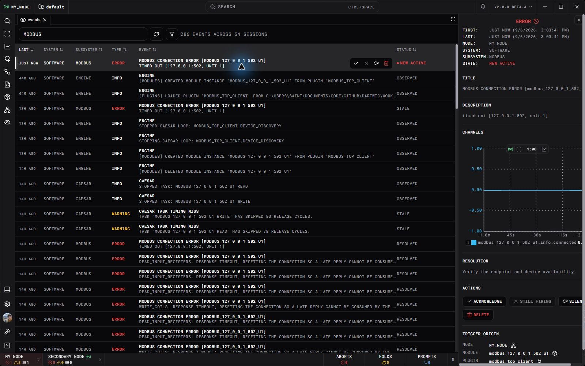

Open **Events** or **Events Board** to review ARGUS records. The bottom event bar highlights current node events, aborts, holds, and prompts. Open an item to inspect its details and available actions.

## Investigate an event

Read the title and description, then the resolution text. The details include node, system/subsystem, source, and related channels when the producer supplies them. Channel graphs help you compare the event with measurements. A graph opened from a recorded event starts paused around its occurrence. Use **Show realtime** in its toolbar to follow current channel values, even after the event stops firing. The time-window field shows the full visible span and can be edited while paused or live.

For declared DCode events, **Trigger Origin** explains what fired the event; **Definition Origin** links back to its declaration. The generated firing and event-state channels appear with that origin context.

Use the board filters to narrow by node, type, status, source grouping, text, session, or time. An event disappearing from the active board does not mean its historical record never existed.

For a retained time range, open **Data → Databases** or a dataframe's event history. The [Telemetry Exporter](Telemetry%20Exporter.md#compare-events-and-logs) can place event occurrences beside channel measurements. These views read the queried node's retained ARGUS history; they do not fetch another node's entire database merely because a peer is connected.

Open the calendar to inspect the selected query range, loaded event coverage, and timestamps of the event rows currently on screen. Scrolling updates the visible range without changing the selected dates.

## Choose the appropriate action

| Action | Meaning |
| --- | --- |
| Acknowledge | Records that an operator has seen the event. It does not clear the physical condition. |
| Resolve | Finishes an event after its firing condition/heartbeat has stopped. |
| Silence | Hides an event from the active board; it does not deassert its trigger condition. |
| Respond | Supplies the answer requested by a prompt. |
| Release hold | Releases the specific hold represented by that event. |
| Delete | Removes the event from the active view through its deletion lifecycle. |

Actions depend on event type and state. A DCode event can be acknowledged while firing, but resolution waits until firing stops. Resolving a new event implicitly acknowledges it first.

A responded prompt shows its submitted answer with the responder icon on the same line. The Engine records a responder origin using the same format as a channel's `commanded_by`; the recorded username appears beside the icon. Hover over it for client details. If that user's current client is connected, the icon can show their avatar. Older responses that recorded only a client ID cannot reliably recover the username after that client disconnects.

## Firing is different from board presence

A declared event's `_firing` channel follows its live trigger condition, or the heartbeat window for one-shot triggers. Its event-key channel follows active-board presence. Silencing can remove board presence while the firing condition remains true.

ARGUS groups reports by node, title, system, and subsystem. Type, source, and description may change on later reports without creating a new logical event. Each report specifies `separation_seconds`: a positive value ends firing after that much quiet time, while zero requires an explicit stop. The end of firing does not acknowledge, resolve, answer a prompt, or clear a physical fault.

This distinction matters for automation: use [DCode `on_firing:`](../DCode/Events.md) for a condition response, not the operator-board state. UI refresh, event telemetry, and history are asynchronous relative to that engine reaction.

An abort event label alone does not define how equipment stops. The event's DCode reaction or device implementation must supply that behavior. Confirm the related feedback channels after taking an action.

For event creation and query contracts, see [Events and ARGUS](../Engine/Events%20and%20ARGUS.md).
