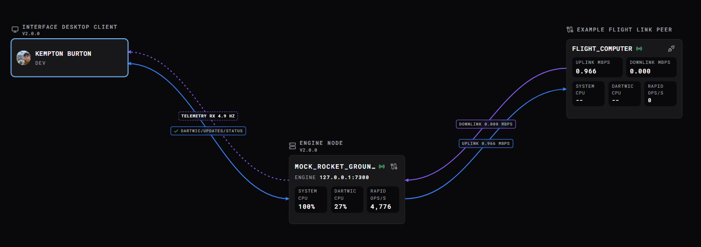

A channel is a named signal: a measurement, command, task status, or calculated value. Open **Channels** to find it and see where they come from and what is controlling them.

# RAPID Channels

RAPID is the backend database the Engine uses to store channels. RAPID was actually the first component of the Engine to be developed, and is designed to be a very fast and flexible storage engine.

Most numeric signals that an operator works with are represented as channel:

| Example          | What the channel represents                                  |
| ---------------- | ------------------------------------------------------------ |
| `tank_pressure`  | A measurement published by a sensor driver.                  |
| `valve_command`  | The position automation or an operator is requesting.        |
| `valve_feedback` | The position reported by the device.                         |
| `fill_task_hold` | A control for holding or releasing a task named `fill_task`. |

A driver can update `tank_pressure`, a task can read it and update `valve_command`, and a schematic can display both. The output driver then delivers that command to the device. Keeping command and feedback as separate channels lets you compare what was requested with what the equipment reports.

For a more technical breakdown of channels, view [Channels and Control](../Engine/Channels%20and%20Control.md). This guide will be more operator and interface focused, rather than a technical breakdown.

A channel contains **fields**: named pieces of information about that signal. Its `value` is the current number. Other fields explain what that number means, when it was updated, where it came from, and who can change it.

For example, a pressure channel might have `value = 12.5` and `units = "bar"`. Its `timestamp` tells you when the source last updated it. These fields all describe the same signal.

To view channels currently in engine memory, open the Channel Searcher, by clicking the Channels tab in the sidebar.

The Channel Searcher has three views: **Channel list** for individual signals, **Modules / Tasks** to browse them by their source, or **Config Map** for one configuration sheet per module. They all have their distinct functions and use cases.

For example, you see that `tank_pressure` has a value error and your tank is blinking in your Schematic. You inspect the node, and open the channel in the **Channel Lists View**, then you check the **Modules / Tasks View**, and see the module is connected and the tasks are running properly. So then you ask you team, and they say they are doing some DAQ remapping, and say analog input #5 is being worked on. You then switch to the **Config Map** view, and see the channel belongs to that input.

The views support similar functions for channels, or toolbar actions. If they don't, the buttons will be disabled. Channel List View is the default view, and is a good intro to most channel functions.

# Channel List View

Use the channel list to view and search all the channels in the engine.

The channel list shows channels in the engine you are connected to, as well as channels in remotely connected engines. These are called **remote channels**, more on those below.
## Nodes and Remote Channels

The channels are categorized by node. A **node** refers to a process, like a DARTWIC Engine, or something else custom, that speaks DARTWIC's language (channels, logs, events, etc). There are two main node types, a **local node**, and a **remote node**.

A **local** node simply refers to the engine you are connected to in the interface. Those channels in the channel list that you edit are considered **local channels**, because they belong to the engine you are currently connected to.

A **remote** node is another DARTWIC Engine, or a custom outside process, that communicates to the Engine you are connected to. The node can supply channels, logs, events, and even custom commands and data.

Remote nodes are implemented through **TEMPEST Peers**. A peer refers to a continuous monitored connection that occurs in both directions. While your Interface is considered a client because it only sends commands in one direction, a TEMPEST Peer can send and receive commands in both directions.

In reality, you will only use local nodes, unless you configure a TEMPEST Peer connection in the [Network Map](Network%20Map.md) (shown below). If you want to read more about TEMPEST Peers, check these out: [TEMPEST Peer](../Engine/Reference/TEMPEST/Telemetry/TEMPEST%20Peer.md), [C++ TEMPEST Peer](../Clients/C++%20TEMPEST%20Peer.md), and [Using TEMPEST](../Engine/Advanced/Using%20TEMPEST.md).

Local channels do not include their node, such as `tank_pressure`. Editing that channel will edit the channel in the connected engine.

Remote channels include their node, such as `TEST_STAND:tank_pressure`. Editing that channel will send an edit command from the currently connected engine, to that remote node. The edit result will then be visible when that remote node sends telemetry to the engine you are connected to, and then to your client Interface.

As of now, only the **Channel List View** supports **remote nodes**.

## Channel Fields

Click a channel to reveal its **fields**. Editable fields have controls; read-only details are dimmed. Some edits require control of the channel.

| Field | What it is for |
| --- | --- |
| `value` | The current number. Editing it sends a command to the channel. |
| `units` | The units or display format for that number. |
| `timestamp` | When the source last updated the value. |
| `stale_timeout` | How many seconds without an update before the channel is shown as stale. `0` disables this check. |
| `record_mode` | Record changed values, every value write, or no write-triggered samples. |
| `value_options` | Labels for numeric values, such as `0 = Closed` and `1 = Open`. |
| `startup_value` | An optional value for the next Engine start. Setting it does not change the live value. |
| `commanded_by` / `created_by` | Who last wrote the value and what created the channel. |
| `control_policy` / `control_owner` / `active_controller` | How writes are controlled, the underlying owner, and who currently has control. |
| `calculation_scripts` | Links to calculations attached to the channel or reading it. |

The image below shows a task owned frequency diagnostic channel. Fields that are white are editable by the operator.

A DARTWIC project can have thousands of channels and hundreds of tasks. Knowing where a channels data is coming from, what commanded it, and what created it is important for setup, troubleshooting, or anomaly investigation.

The channels `commanded_by`, `created_by`, `control_owner`, and `active_controller` all have something called **Origin Strings**. This metadata describes the context of origin for that channel field.

In the image above, you can see which task this channel belongs to in the `created_by` field. You can also see the module that the task was created for, and which node created that channel.

You can also see the last operator that commanded that channel in `commanded_by`.

These icons can be clicked to open the resource in question, and bring you to the exact task, DCode script, task, device module, etc., in question.

To edit a channel that is being controlled, you would need to set `control_policy` to manual override. The owning task would then not be able to command that channel.

You can then update it, and then release it back to automation by clicking the red release button.

The channel is yellow because it is connected to a warning event that is thrown by RAPID when it notices a control rejection occurs.

Every single channel is able to be overridden by an operator. Be careful though, any channel you override will have to be manually released back to automation. If you forget, your automation might not work properly as tasks would not be able to touch it.

## Channel States

Channels have a few important states the operator should be aware of. Use state badges or toolbar filters to find channels that need attention.

| State | Meaning |
| --- | --- |
| **Stale** | No new source timestamp has been observed within the freshness timeout. Check the source and its connection. |
| **Not Found** | The channel is missing or its remote source is unavailable. A retained value can still be shown. |
| **Manual** | An operator has taken manual override. |
| **Automatic override** | A controller has temporarily taken priority over ordinary automation. |

As mentioned above, it could be bad if a channel is left in manual override and forgotten. All states are explicitly shown in the node header, and as well as the channel row itself, to make these conditions easy to see. You can click the badges to sort by state or event.

Another common state is the `stale` state. This state is triggered when a channels `stale_timeout` has been reached, meaning,  that channels source has not published a new channel measurement for that timeout time in seconds.

This is useful to see if a sensors data acquisition task has stopped or halted.

Not found occurs when a channel that is being shown in the searcher no longer exists in engine memory. This can happen when someone else deletes a channel when you are viewing it.

For remote channels, not found occurs when the remote node has lost connection, meaning you cannot command or query that channels value.

**Not Found** takes color priority, followed by active events, then staleness.

## Channel Events

Events can reference channels, such as a pressure warning linked to `tank_pressure`. Active events add an icon and color to the channel.

Click the icon to open the [Events](Events.md) board, or choose an event if several are linked. The board provides details, acknowledgement, and prompt/hold actions.

# Toolbar and Context

Most views share similar toolbar actions. Hover a button for its name; unavailable actions are disabled.

**Ctrl-click** to select several channels; **Shift-click** selects a range. You can graph or delete the selection. Rename and Find references need one channel. Changes involving linked resources open [Project Actions](Node%2C%20Context%2C%20and%20Project%20Board.md#project-actions-and-references) for review.

You can also **Right-click** a channel to show actions such as rename, copy channel name, open in telemetry graph, etc.

# Modules / Tasks View

This view groups channels by their module, task, or Engine service. Use it to find signals belonging to a device or procedure.

Expand a group to inspect channels; its source icon opens the related editor. Task headers show measured rate and supported Start, Stop, and Hold controls. Click a control, then its check mark to confirm. [Modules and Tasks](Modules%20and%20Tasks.md) covers task operation.

This view can be super useful to determine where a channels data actually comes from, and can make it easier to manage tasks related to those channels, instead of having to click on the **Origin String Button** to open the respective task and edit its settings.

# Config Map View

This view is a little different than the other two. Instead of only showing channels in the engines memory, this view also shows common configurations used by **Plugins**, **Tasks**, or **Modules**.

The Config Map puts a module's settings and linked task mappings on one sheet. Plugin settings have separate sheets.

Right-click a channel and choose **Show config…** to open Config Map with that channel as the search. Matching sheets are selected and the matching field is brought into view.

Config options depend on the plugin. If the plugin does not use the shared `Config Map` APIs, then a **Open Config** button leads to its dedicated view when no configuration table is available.

Config from all over the project is pulled from modules, tasks, and plugins, and shown here. Edit in the map view, see the changes in the task. The interface is not storing the config in a separate place, its just another way to view and edit existing config.

This can be very useful when you want to quickly configure a hardware setting, or find how a RAPID channel maps to your hardware. For example, finding which analog input address the channel `tank_pressure` maps to.

Config edits remain drafts until you choose **APPLY**; **CANCEL** discards them, and Escape reverts the active cell.
