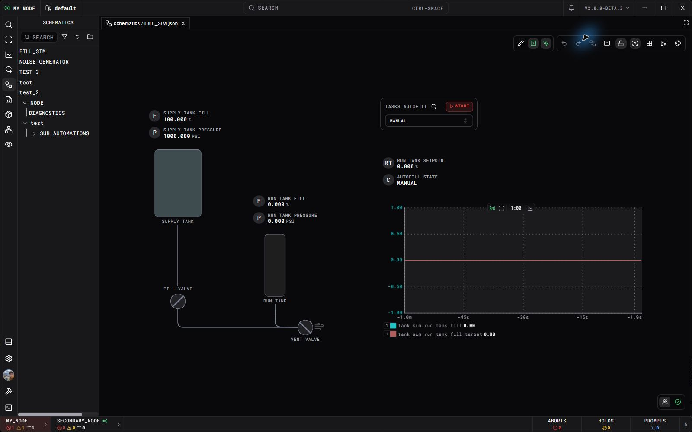

A schematic puts live signals and controls in the context of the equipment they represent. It is a saved project resource: operators can reopen the same layout without rebuilding a channel search.

This is an example project, not a schematic included with every installation. Its channel names and controls come from that project's simulation and automation.

## Open and navigate

Choose **Schematics** in the left navigation and open a resource. Use the toolbar's fit-view control to bring all nodes into view, especially after resizing a panel. Pan and zoom to inspect a section. The context panel follows the selected node.

The toolbar separates editing and interaction modes. Use editing to arrange and configure the diagram; use interaction mode to operate its controls. Check the tooltip of an icon to identify its action.

## Build a view

1. Create a schematic resource in the project's resource list, or open one you can edit.
2. Enter edit mode and add a node from the node palette. Channels can also be dragged into the canvas from supported channel lists.
3. Select the node and configure its channel reference or other properties in the context panel.
4. Arrange and resize the nodes. Use labels, connections, and diagrams to show what each signal belongs to.
5. Check the resource's save/synchronization state, then switch to interaction mode and verify the displayed values.

The node palette previews remain visible outside edit mode; enter edit mode to drag a node onto the schematic. Its category strip scrolls horizontally when the tabs do not fit. **Channel parameter card** and **Channel control card** provide card layouts for the same channel display and control nodes. Dragging a channel from Channel Search onto the schematic also offers both compact and card layouts for these nodes.

Channel status distinguishes an explicit missing-channel response from telemetry that has not arrived or is not subscribed. Task cards retain their last successful task inventory when a refresh fails; a failed request alone does not establish that a task was removed.

Channel graphs use each series' selected line color. Their legend values show
stale data in the stale color and unavailable data in Not Found purple, retaining
the last number when available. Status segment overlays are omitted while existing
recorded-gap breaks remain. The same renderer serves Telemetry and event details.

In command mode, select mission time or target T0 on a timeline task card to edit it. The full card also has a shift button beside mission time. Submit the time to preview the resulting clock position, choose an action for each crossed bucket, then apply the change. The input is replaced by the preview and its single Apply Time button; select Edit to enter a different time. Preview holds a running timeline; it stays held after applying until you resume it. These task operations do not require manual control of the timeline's read-only clock status channel.

The timeline schematic card uses the same bucket Gantt as the Tasks resource in a compact, automatically following layout. Its bucket bars use mission-time start and end readbacks; the Tasks resource labels elapsed duration separately because that duration can be longer than the bar's T-time span when the clock was held.

Nodes linked to an ordinary ARGUS event blink in that event's color while it is new and still firing. Linked prompts and holds, including a timeline clock hold, keep blinking while they await a response or release, even after their firing interval ends or they are acknowledged. Completing the prompt or hold removes its blink.

Use **Import media node** in the palette to add an SVG or image as a reusable node. Give it a name and category; after saving, it appears in that category and can be dragged onto a schematic in edit mode. Names must be unique among the available nodes in that category.

| Node | What to configure |
| --- | --- |
| Channel display | Channel reference, label, units/format, and visual style. |
| Button, switch, or slider | Command channel, values or range, and operator-facing label. |
| Task control | Task identity and the controls exposed to the operator. |
| Graph | Channel series, time window, and axis/display options. |
| Image or SVG | Diagram asset and its layout. |
| Diagram | Imported mxGraph/draw.io diagram and its layout. |
| 3D model | GLB/glTF asset, camera, display mode, and part colors. |
| Remote view | Source schematic or embedded view configuration. |
| Plugin node | Properties supplied by the installed plugin. |

## Use graphs

A graph can compare several channels and show configured thresholds. Use an appropriate time window for the process; a very short window reveals recent changes while a longer one helps identify a trend. Open [Telemetry Exporter](Telemetry%20Exporter.md) when you need a historical range or CSV.

Graph rendering and channel telemetry are asynchronous. The graph's update setting does not set acquisition or automation frequency.

## Operate controls

A schematic button writes through the engine's normal authority rules. If it is disabled or the value does not change, inspect the underlying channel in [Channel Search](Channel%20Search.md). Check `control_policy`, the active controller, and whether the signal belongs to a remote node.

Channel displays show the current `value_options` label as read-only. Channel controls can offer those options as named choices. Selecting a choice on a control sends its configured value through the same command authority checks. A control configured to call a TEMPEST operation uses that operation's arguments and access permissions.

An output command and measured equipment state may be different channels. Display both when operators need to confirm the physical result. See [Commanding and Control](../Engine/Commanding%20and%20Control.md).

For a valve with separate command and feedback channels, the blue commanded position marks the requested state and the valve stem or fill marks the measured state. Set the control's open and closed values to match the device encoding. If both references name the same channel, the schematic has no independent feedback to compare.

The commanded marker moves to the requested position immediately. The feedback stem moves toward each new readback at a steady visual rate, so its movement remains distinct from the command and does not restart an easing animation at every sample.

## Show equipment in 3D

Add a **3D model** node and import a GLB or glTF 2.0 model. Include the glTF's referenced buffers and textures; the complete import is limited to 20 MiB. The asset is saved with the schematic.

Use the model's part list to assign fixed colors or channel-driven colors. A gradient maps a numeric range to colors; state colors map configured values to colors. Configure the fallback for missing or stale signals so a lost measurement does not look like a current equipment state. **X-ray** mode helps expose internal parts without changing the model asset.

For a custom palette node, follow [Interface Plugin](../Plugins/Interface%20Plugin.md) and the [schematic-node reference](../Plugins/Reference/Interface/Schematic%20Nodes/Overview.md).
