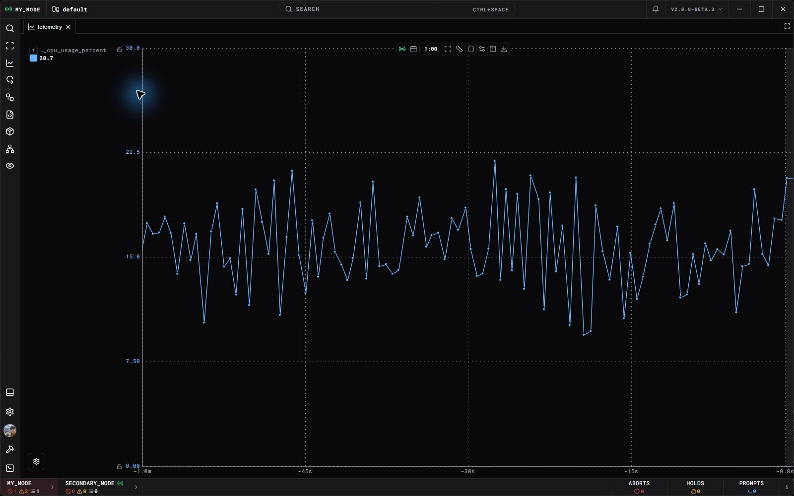

Open **Telemetry** from the left navigation, or open selected channels from Channel Search, a DataFrame, or a supported schematic graph. The Telemetry Exporter combines a historical graph with range selection, series configuration, and CSV export.

A live channel may have no recorded history. Check its `record_mode` and [DataFrame](DataFrames.md) before querying.

## Query a range

1. Add one or more channel series, such as `|tank_pressure|`.
2. Set the date range and start/end times. Choose a range that overlaps the recorded samples.
3. Set the data-frame filter when you want one historical group.
4. Run or refresh the query. Changing supported series and query settings also refreshes the preview.
5. Compare the graph with the returned-point and raw-point counts in the settings panel.

The live/realtime view follows a moving time window; a historical range stays bounded. Use the graph's zoom, visible-range controls, and series visibility to inspect a particular transition. Series can use separate Y axes when their units or scales differ.

## Preview settings

| Setting | Effect |
| --- | --- |
| **Bucketing: Auto** | Chooses a preview point budget based on graph width. |
| **Bucketing: Off** | Requests raw points for the graph. |
| **Bucketing: Custom** | Uses your preview point cap. |
| **Timeout Seconds** | Bounds how long the query waits. |
| **Display Format** | Shows or hides node, channel name, and field in labels. |

**Bucketing affects the graph preview. CSV export always uses raw recorded data.** A smooth or sparse preview is not evidence that the original recording contained only those points.

## Export a visible range

Pause the graph, then open **Export telemetry** in its toolbar. Check any combination of **Channels**, **Logs**, and **Events**, and choose **Export visible range**. Export is disabled while following live telemetry. Each selected type uses the same full visible X-axis range, including portions with no preview samples. Bucketing and the rows currently loaded in the accompanying panels do not limit the export.

Channel export includes the union of that graph's plotted series and checked channels in the open dataframe channel list, with duplicate references removed. You can export checked channels with an empty graph; adding them to the plot is optional. Closing the dataframe panel or switching frames removes its old checkbox selection from the export scope. The Channels checkbox row shows nonzero plotted and selected counts inline. Logs and Events show their matching log and logical-event counts for the same range and saved-frame filters. Counts load only while the menu is open; zero labels are omitted and unavailable counts show a dash. The range is captured when the menu opens, so the displayed counts and export share the same bounds.

Channels download as raw CSV; logs and events download as separate JSON Lines (`.jsonl`) files, including all matching history pages and event occurrences. The browser may request permission for multiple downloads when you select several types. Channel exports run as background engine jobs; the interface shows progress, completion, or failure, and supports cancellation while a job is active. Web downloads use the current authenticated session. A failed download appears as an interface error.

Channel CSV exports read bounded batches and use temporary disk files to sort raw samples into timestamp order. They do not load the entire selected history into memory. Sorting and wide CSV output still take time and disk space, especially with many channels and distinct sample timestamps. The CSV preserves empty cells where a channel has no value at a timestamp; repeated samples for the same channel and timestamp use the last recorded value.

The popup's **Stage** line shows current work and actual counts: channels counted, datapoints read or sorted, datapoints merged in the current numbered merge pass, or datapoints processed and CSV timestamp rows written. For example, `Merging samples - 420,000 / 1,200,000 datapoints - pass 2 / 3`. Each merge pass has its own counter; datapoints are not counted as newly exported again. Downloading shows received / total MB when the HTTP response supplies a total, or received MB otherwise.

The overall percentage advances through counting, reading, sorting, writing and download without restarting at each stage. It estimates work, not time remaining. The datapoint figure is the counted input total after counting finishes, separate from progress; it includes repeated timestamps and can differ from the CSV row count. If recording retention reclaims history during an export, retry the export after cleanup finishes.

Every export opens the shared progress popup. It shows the current file, completed-file count, engine progress when available, and download progress when the response includes a byte total. Unknown totals use an animated bar. **Cancel export** or the popup's **X** stops remaining work; cancellation can take time to settle. Outside clicks and Escape do not dismiss the popup, including after completion: use **Close** or **X** explicitly. Files already sent to the browser download manager are kept.

Reloading, leaving the exporting view, disconnecting, or switching clients stops the export and prevents remaining downloads. TEMPEST cancels client-owned jobs when it unregisters the client or detects its lost connection; running jobs observe cancellation cooperatively. Reconnecting does not resume an export.

If the interface host cannot download over HTTP, the error includes the engine's local output path when available. The [Databases](Recorded%20Data.md#export-a-selected-range) have a matching **Export selected range** control for their calendar selection.

## Compare events and logs

Enable the graph's **Events** or **Logs** toggle to open ARGUS history for its displayed time range. Enabling either while following live data freezes the graph at that range. Moving or zooming the historical range updates the accompanying history.

The activity strip beneath the graph shows events above logs when both are enabled. A blue outline marks the time span covered by each panel's current paged history window; severity colors remain visible. It reaches the graph range's left or right edge when paging has confirmed there are no more matching records in that direction, even when the first or last record lies inside the range. The marker updates as pages load or leave the retained window and clears when the range or filters change. An outlined span does not mean there is a record at every time in that span. The panels use the graph's time range, without separate range or loaded-time labels.

Select a timeline item to inspect the event or log alongside the measurements. The history readers load bounded pages; the visible items are not a count of every record in the database. [ARGUS Events](ARGUS%20Events.md) explains event actions, and [Logs](Logs.md) explains streams and sessions.

To keep a run's range, channels, and ARGUS selection together, create a [dataframe from history](DataFrames.md#group-existing-history). Export that frame as a ZIP when you need events and logs as well as channel CSV files.

## Empty or slow results

| Symptom | Check |
| --- | --- |
| Live signal, empty history | `record_mode`, data-frame filter, and recording time coverage. |
| Recent samples missing | Persistence queue/flush status; recording is asynchronous. |
| Huge raw-point count | Narrow the channels or time range; use Auto bucketing for preview. |
| Query times out | Reduce the range first, then adjust timeout if needed. |
| Remote signal has no local history | Recording availability on the queried node and frame. |

For repeated analysis, use the [Python client](../Clients/Python%20Client.md#example-find-recorded-channels-and-plot-their-history). [Telemetry and History](../Engine/Telemetry%20and%20History.md) explains timestamp units and recording semantics.
