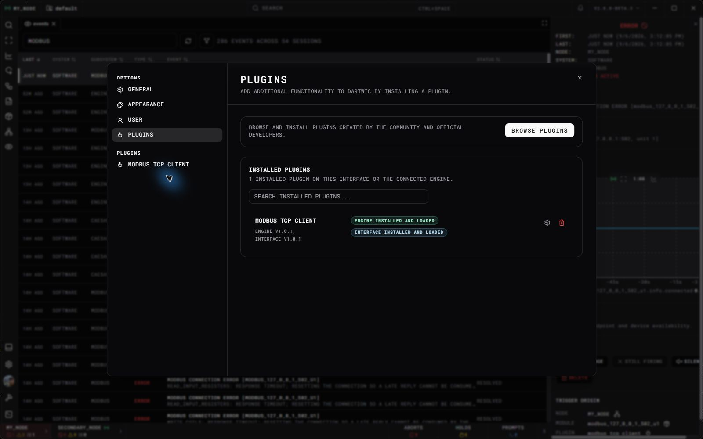

Build from the [example plugin](Overview.md) and keep one root manifest as the source of package identity. Its scripts generate the per-side manifests and output layout.

## GitHub release contract

Create one public GitHub release per plugin version. Attach these files directly as release assets:

```text
v2.0.0
  plugin.json                 # required shared manifest
  plugin-win32-x64.zip         # Windows x64; upload if supported
  plugin-linux-x64.zip         # Linux x64; upload if supported
  release-manifest.json        # optional checksums produced by the tooling
```

A plugin containing a native Engine side must upload at least one of the platform ZIPs above. An **Interface-only plugin** instead uploads **`plugin.zip`**, with the same root `plugin.json` and optional checksum receipt. Its manifest must explicitly set `contains_engine_plugin: false` and `contains_interface_plugin: true`. No separate Windows/Linux build is needed for a portable JavaScript bundle.

Filenames are exact and case-sensitive. Native Engine plugins cannot use `plugin.zip`; separate `plugin-debug.zip` assets are not supported. GitHub's automatically generated source ZIP/TAR is not an installable plugin package. Keep the same root `plugin.json` in the tagged source; browser hosts read it from that tag. The tag, package version, uploaded manifest, and manifests inside the ZIP must identify the same plugin version. For version `2.0.0`, use tag `v2.0.0`.

The combined example uses this complete manifest:

```json
{
  "id": "example_device_plugin",
  "name": "Example Device Plugin",
  "description": "A device driver and its operator tools.",
  "author": "Your team",
  "version": "2.0.0",
  "minEngineVersion": "2.0.0",
  "minInterfaceVersion": "2.0.0",
  "contains_engine_plugin": true,
  "contains_interface_plugin": true
}
```

Use a stable ID matching the runtime definition and every `<id>` directory. Both `contains_*` fields are booleans and at least one must be true. A native side requires `minEngineVersion`; an Interface side requires `minInterfaceVersion`. These are tested minimum host versions using SemVer ordering, independent of the plugin's version. A minimum of `2.0.0` rejects `2.0.0-beta.1`.

Every plugin ZIP, including an Interface-only `plugin.zip`, has exactly one top-level `plugin/` directory:

```text
plugin/
  engine/<id>/
    plugin.json
    bin/<id>.dll              # Windows Release; lib<id>.so on Linux
    bin/<runtime dependencies>
    ...                       # native configuration/default files
  engine-debug/<id>/
    plugin.json
    bin/<id>.dll              # Windows Debug; lib<id>.so on Linux
    bin/<id>.pdb              # Windows debug symbols
    bin/<debug runtime dependencies>
    ...
  interface/<id>/
    plugin.json
    ui/index.js
    ...                       # UI assets
  files/                      # optional content copied to the engine installation
    workspace/                # portable content for the selected workspace
```

Omit both native directories for Interface-only plugins; omit `interface/` for native-only plugins. All included `plugin.json` files must match the root release manifest. Native packages include **both Release and Debug** in the same platform ZIP. A Release engine installs `engine/`; a Debug engine installs `engine-debug/`. There is no separate debug asset to select. Bundle each configuration's required runtime libraries beside its native library; Windows Debug packages include the plugin PDB. Linux Debug libraries retain compiler debug information.

The Engine chooses its own OS and architecture from the platform download map, independently of the Interface machine. A Windows Interface connected to a Linux Engine downloads its local UI from the Windows ZIP and sends both download options to the Engine; the Engine chooses the Linux ZIP. Missing platforms produce an unavailable-download error, never a fallback to another OS. Keep the Interface bundle identical between platform ZIPs. An Interface-only plugin uses one portable `plugin.zip`. The installer offers it on every Interface host and the browser labels it **Any platform**. This exception is never applied to a plugin declaring an Engine side.

## Build and publish

```sh
npm ci
npm run verify
npm run package
```

For a plugin declaring an Engine side, run `package` on each native platform you support: Windows x64 creates `plugin-win32-x64.zip`; Linux x64 creates `plugin-linux-x64.zip`. It builds both native configurations and the Interface bundle, checks manifests, native OS/architecture, Debug output and Windows symbols, then writes the ZIP and SHA-256 receipt. A failure stops packaging; Debug is not best-effort. `package-debug` is an alias for the same complete package. For an Interface-only manifest, `package` builds the JavaScript bundle once and creates `plugin.zip`; it does not require a supported native build host. Deploy commands remain separate and never publish anything.

Native builds require Node.js, CMake, and vcpkg (`VCPKG_ROOT`), plus Visual Studio 2022 with ClangCL on Windows or Clang, Ninja, and `zip` on Linux. Linux builds need the development prerequisites for the dependencies listed in `vcpkg.json`. To reuse an existing vcpkg installation, optionally set `DARTWIC_VCPKG_INSTALLED_DIR` to its installed directory. Interface-only packages need Node.js and a ZIP utility, with no C++ toolchain or vcpkg.

Commit your source and matching manifests before creating the tag. Upload only the generated platform packages you actually built, plus the root manifest. For example, after collecting both platform builds:

```sh
gh release create v2.0.0 plugin.json plugin-win32-x64.zip plugin-linux-x64.zip --target main --title "2.0.0" --notes-file RELEASE_NOTES.md
```

For an Interface-only release, use the same process with just one ZIP:

```sh
gh release create v2.0.0 plugin.json plugin.zip --target main --title "2.0.0" --notes-file RELEASE_NOTES.md
```

Attach `release-manifest.json` as well when desired. Each platform build's receipt covers that build's assets; combine checksums when collecting several builds. Verify on a compatible host before claiming device, driver, or real-time support. Source builds and package checks alone do not qualify physical hardware.

## Install locally

For a local development installation, set the destination roots and let the starter copy the correct files:

```powershell
$env:DARTWIC_ENGINE_DIR = 'C:\DARTWIC\engine'
$env:DARTWIC_INTERFACE_DIR = 'C:\DARTWIC\interface'
npm run deploy
```

Use your actual shared engine installation directory and interface plugin host root. The engine directory contains `bin/`, `plugins/`, and `instances/`; it is not an individual instance's configuration directory. You can instead copy `deployment-settings.example.json` to `deployment-settings.json` and set `engine_dir` and `interface_dir`. `deploy-debug` targets a debug engine; `deploy:interface` rebuilds and copies only UI.

For a manual install, stop all engine instances using that installation before replacing engine files, and stop the interface host before replacing its loaded files. Extract the archive and copy each **ID directory**:

| Package source | Installation destination |
| --- | --- |
| `plugin/engine/<id>/` | `<engine-directory>/plugins/<id>/` |
| `plugin/interface/<id>/` | `<interface-host-root>/plugins/<id>/` |
| Contents of `plugin/files/` | Corresponding paths beneath `<engine-directory>/`. |

Each installed side needs its own valid `plugin.json`. Preserve the native `bin/` and UI `ui/` subdirectories and all dependencies. Do not place the entire ZIP or an extra `plugin/engine/` wrapper inside the installed ID directory.

Start the engine and reload the interface. In **Settings → Plugins**, check the installed side, version, and any load error. Create a module instance only after its engine plugin is loaded. See [Interface Plugins](../Interface/Plugins.md) for the normal plugin-browser workflow.



## Publish for the plugin browser

1. Commit the source and root `plugin.json` to a public GitHub repository. Include a README with setup, supported hardware, compatibility, and troubleshooting.
2. Build and verify on every platform you intend to publish. Create a GitHub release for the same source version with **`plugin.json`** and **`plugin.zip`** for an Interface-only plugin, or the selected **`plugin-win32-x64.zip`** and/or **`plugin-linux-x64.zip`** assets for a native plugin. Keep the manifest in the tagged source too; browser hosts read it from the tag. The manifest determines whether the portable or native archive rule applies.
3. Submit a pull request adding your entry to [`data/plugin-registry.json`](https://github.com/kemptonburton/dartwic-public/blob/main/data/plugin-registry.json). It is a JSON array; add an object like this inside the array:

```json
{
  "id": "example_device_plugin",
  "name": "Example Device Plugin",
  "author": "Your team",
  "description": "A device driver and its operator tools.",
  "repo": "your-org/your-plugin-repository"
}
```

The registry points to your repository. The plugin browser resolves published releases, checks the manifest ID and minimum host versions, and selects the archive for each actual host. A Windows Interface connected to a Linux Engine installs the Windows UI files locally and sends the Linux archive location to the Engine. If either required platform archive is absent, that side is unavailable until a new plugin version supplies it. A source-only tag is useful as a developer starter but is not an installable plugin-browser release without a manifest and matching archive.

Plugin cards show package download counts, including zero, and Windows/Linux badges for native platform ZIPs, or **Any platform** for an Interface-only `plugin.zip`, in the latest release. Counts total package downloads across published releases, not unique users or installations. Cards and plugin pages share the same status badges, platform badges, and download count. A yellow warning icon shows installation or release issues on hover or keyboard focus; the count has no tooltip.

Linux native plugins do not need a separate archive for each real-time kernel. The maintained Linux x64 release workflow builds on Ubuntu 24.04. Installation on other distributions needs dependency and runtime validation. Each plugin owns setup guidance and handling for external libraries it needs. LabJack's LJM library is a separate host prerequisite described by the LabJack plugin; DARTWIC's generic package installer does not install or preflight that vendor driver. Verify device access and permissions for Modbus and EtherCAT on the actual machine before operating hardware.

| Problem | Check |
| --- | --- |
| Not listed publicly | The registry entry has been accepted and its `repo` is correct. |
| No compatible release | The manifest and a matching platform ZIP exist and the relevant minimum host version is satisfied. |
| Installed folder marked invalid | Its manifest has the required side flag, ID, version, and minimum version. |
| Engine library fails to load | OS, architecture, debug/release mode, SDK compatibility, and binary dependencies. |
| UI installs but does not appear | `ui/index.js`, the registry definition, matching IDs, and interface reload. |
