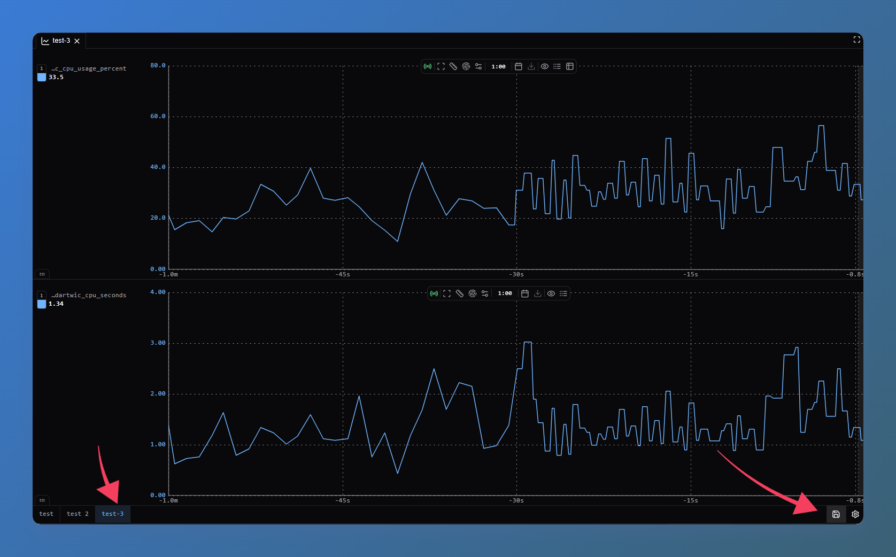
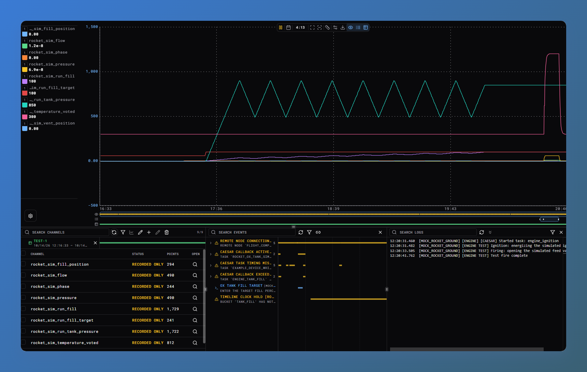

<!-- DARTWIC:RELEASE-ARTIFACTS:START -->
## Release artifacts

This is a bundled DARTWIC release. Each artifact is versioned and delivered separately.

| Artifact | Version | Minimum Engine | Minimum Interface |
| --- | --- | --- | --- |
| [DARTWIC Engine](https://github.com/kemptonburton/dartwic-public/releases/tag/engine-v2.1.0) | 2.1.0 | — | — |
| [Desktop Interface](https://github.com/kemptonburton/dartwic-public/releases/tag/interface-desktop-v2.1.0) | 2.1.0 | 2.1.0 | — |
| [Webserver Interface](https://github.com/kemptonburton/dartwic-public/releases/tag/interface-webserver-v2.1.0) | 2.1.0 | 2.1.0 | — |
| [React Client](https://github.com/kemptonburton/dartwic-public/releases/tag/react-client-v3.0.0) | 3.0.0 | 2.1.0 | — |
| [Python Client](https://github.com/kemptonburton/dartwic-public/releases/tag/python-client-v3.0.0) | 3.0.0 | 2.1.0 | — |
| [TEMPEST Peer](https://github.com/kemptonburton/dartwic-public/releases/tag/cpp-peer-client-v3.0.0) | 3.0.0 | 2.1.0 | — |
| [Engine Plugin SDK](https://github.com/kemptonburton/dartwic-public/releases/tag/engine-sdk-v3.0.0) | 3.0.0 | 2.1.0 | — |
| [Interface Plugin SDK](https://github.com/kemptonburton/dartwic-public/releases/tag/interface-sdk-v2.1.0) | 2.1.0 | — | 2.1.0 |
| [DARTWIC Engine Protocol SDK](https://github.com/kemptonburton/dartwic-public/releases/tag/dartwic-peer-protocol-sdk-v3.0.0) | 3.0.0 | 2.1.0 | — |
| [DARTWIC Example Workspace](https://github.com/kemptonburton/dartwic-example-workspace/releases/tag/v2.1.0) | 2.1.0 | 2.1.0 | 2.1.0 |
| [DARTWIC Example Plugin](https://github.com/kemptonburton/dartwic-example-plugin/releases/tag/v2.1.0) | 2.1.0 | 2.1.0 | 2.1.0 |
| [DARTWIC Node.js Client](https://github.com/kemptonburton/dartwic-public/releases/tag/node-client-v3.0.0) | 3.0.0 | 2.1.0 | — |
| [DARTWIC C++ Client](https://github.com/kemptonburton/dartwic-public/releases/tag/cpp-client-v3.0.0) | 3.0.0 | 2.1.0 | — |
| [Modbus TCP Plugin](https://github.com/kemptonburton/dartwic-modbus-tcp-client/releases/tag/v1.1.0) | 1.1.0 | 2.1.0 | 2.1.0 |
| [LabJack T7 Plugin](https://github.com/kemptonburton/dartwic-labjack-plugin/releases/tag/v1.1.0) | 1.1.0 | 2.1.0 | 2.1.0 |
| [EtherCAT Plugin](https://github.com/kemptonburton/dartwic-ethercat-plugin/releases/tag/v2.1.0) | 2.1.0 | 2.1.0 | 2.1.0 |
| [F Prime Bridge](https://github.com/kemptonburton/fprime-dartwic-plugin/releases/tag/v2.1.0) | 2.1.0 | 2.1.0 | 2.0.0 |
| [Checklists](https://github.com/kemptonburton/dartwic-checklists-plugin/releases/tag/v2.1.0) | 2.1.0 | 2.0.0 | 2.0.0 |
| [Documentation](https://github.com/kemptonburton/dartwic-public/tree/docs-v2.1.0) | 2.1.0 | — | — |
<!-- DARTWIC:RELEASE-ARTIFACTS:END -->

## Overview

DARTWIC 2.1 brings together the changes made since DARTWIC 2.0: a simpler way to build connected applications, shared configuration editors, improvements to DCode and channel ownership, and a lot of smaller fixes across the Interface.

A lot of this update started with the documentation. Working through the guides showed where explanations were hard to follow—and where the software itself was asking people to do too much. We improved both, and will keep doing that!

# Config Maps: less work to configure a plugin

Config Maps give plugin settings, modules, and tasks a shared configuration editor. A plugin describes its fields and mapping rows; DARTWIC handles the forms, validation, and saving.

Search for a channel in the Channel Searcher to trace it back to hardware bindings or plugin settings:

Keep a device's settings, linked tasks, and channels together. Search across configuration sheets and jump to the matching field without opening every task. Long sheet lists have a searchable overflow picker, and narrow panels make better use of their space.

Shared editors preserve drafts during saves and report conflicting changes. Existing Apply/Cancel and automatic-save workflows remain in place.

The Example, Modbus, LabJack, and EtherCAT plugins now use Config Maps. Plugin authors can also reuse them inside custom layouts.

# A simpler way to connect nodes

TEMPEST peer integrations now use the same three main objects throughout DARTWIC:

- **Transport** moves messages over the link.
- **Peer** handles registration, heartbeats, requests, replies, and dispatch.
- **EngineProtocol** provides channels, events, logs, and their handlers.

The Engine and C++ applications now share `EngineProtocolPeer`. Use the built-in ZeroMQ/TCP transport or supply your own, without creating a database just to connect. Existing `PeerClient` names remain supported.

The Network Map's **Connection type** selector explains the choices: an Engine Protocol Peer shares channels, events, and logs; a TEMPEST Protocol Peer supports custom operations and telemetry.

Reconnection and forgetting peers have also received fixes, including preventing queued telemetry from restoring data after a connection has been removed.

Channel APIs use `upsert`, `query`, and `remove`, with clearer command and telemetry handlers. Incremental updates report changes; complete snapshots keep connected nodes synchronized, including removals.

Plugin authors use `registerPeerTransport` for a new link between DARTWIC applications, or `registerPeer` for a device-protocol bridge. The Engine supplies the bridge's Peer and EngineProtocol so it can publish measurements and handle commands directly.

# DCode and channel control

Timed conditions such as `when(|sensor_ready| == 1, time=0.5):` wait for a condition to stay true across evaluations before running a block, without blocking the surrounding work. A false evaluation resets the timer; once qualified, the block runs on each qualifying evaluation. Use `if` for an immediate check or `wait_until` when the procedure itself should wait.

Nest `once:` inside `when` for work that should run only once during that runtime section's execution.

Channel-control statements are more consistent: `command`, `set`, `override`, and `free` work with or without a value. Operator manual overrides retain priority. Rejected operations leave the channel unchanged and warn without stopping the task body.

Runtime cleanup now waits for final handlers and in-flight callbacks before discarding old work. Reusing a task name does not inherit an old runtime's claims, and releasing a channel keeps its last value.

The editor has fixes for syntax, channel references, and variable navigation. These automation changes also apply to Native C++ DCode.

# Events, recording, and telemetry

Event history now distinguishes repeated detections from separate firing periods, with compact count badges and exact values in details. Reports can stop firing after an inactivity timeout or explicitly through `stop_event_firing`; holds and prompts end through their workflow.

The C++ plugin SDK now follows DCode's event names and arguments, including typed prompts and holds. The old `consoleError` and `stopEventFiring` names have been removed; bundled native plugins use the updated SDK.

Peer synchronization retains complete 5 Hz snapshots, with fixes for duplicate event/log records and disconnected-node display. Recording, log delivery, and network diagnostics also received background-processing improvements. Locally saved history remains available when a peer disconnects.

The new `every_value_exclude_autorecord` mode saves every submitted measurement without mixing in periodic snapshots. The LabJack stream worker uses it so acquisition gaps stay visible in history. Graph tooltips and telemetry CSV exports can also show who wrote each sample.

# Review and export a run

Save arrangements of multiple telemetry graphs and reopen them across the workspace, with each graph's channels, window, and settings ready to use.

Click a dataframe to open its run in Telemetry. Channel traces, events, logs, and dataframe ranges share a time axis, with blue highlights showing loaded records. Export channels, events, and logs together for the period you are viewing, or a whole dataframe as a ZIP. Events, Logs, and databases also offer selected, loaded, and visible range exports.

# Device feedback and the example workspace

The Example Plugin distinguishes the command you send from the state you observe, using matching `_state` channel names. Command and readback mappings appear together where supported. Module connection status is also independent of whether its acquisition task is running.

The example workspace follows these changes and includes the simplified C++ flight peer, with matching plugin sources and launch tools.

The F Prime bridge uses the same Engine-supplied Peer and protocol, retaining dictionary-driven measurements, events, and commands. It was exercised with Hadron SITL and native fixtures; command execution is confirmed through flight-system events or telemetry.

# Smaller improvements you will notice

- **Graphs and channel search:** less repeated processing for large selections, with clearer stale/missing indicators and real data gaps preserved.
- **Module and task views:** compact type pickers with search and filters make creation easier. Shared connection indicators, linked-task controls, and configuration sheets keep a device's settings and channels together.
- **Project Actions:** clearer selection, progress, cancellation, and retries, with advisory warnings and overrides where allowed.
- **Workspace startup:** improved creation, instance paths, and reporting of missing folders.
- **Resources:** safer removal of empty folders and groups. Shared editors show other operators' cursors and selections; hide them in Interface settings while keeping live editing active.
- **Plugin management:** clearer catalogs, settings, installed/loaded versions, and restart indicators.
- **Configuration editing:** more consistent draft handling, search highlighting, tab overflow, and save controls across the shared editors.

# Guides that explain the whole workflow

The **2.1.0** docs cover Getting Started, the Interface, Engine, DCode, plugins, and clients. Interface guides are now visual walkthroughs: what each resource is, where to find it, and how to use it, with links to deeper explanations.

The peer guides were rewritten around complete send/receive examples for connected Engines, custom C++ applications, and device bridges. Storage, recording, export, and client examples also received corrections.

# Plugins and developer packages

The coordinated update includes refreshed SDK snapshots, compatibility requirements, and examples:

| Component | Version |
| --- | --- |
| Engine, Desktop Interface, Webserver Interface, and documentation | 2.1.0 |
| Example Plugin and example workspace | 2.1.0 |
| EtherCAT plugin | 2.1.0 |
| LabJack T7 and Modbus TCP plugins | 1.1.0 |
| F Prime bridge and Checklists | 2.1.0 |
| Python, Node, React, C++, and C++ Peer Client libraries | 3.0.0 |
| Engine Plugin SDK and Engine Protocol SDK | 3.0.0 |
| Interface Plugin SDK | 2.1.0 |

The Interface SDK advances to 2.1.0 with Config Map declarations and updated shared types. Checklists has been rebuilt with that SDK; it remains an Interface-only plugin and does not depend on the native Engine plugin ABI.

# Upgrading to 2.1

Update the Engine and Interface together, then use the matching native plugins and client libraries. This release advances the **Engine plugin ABI to 6** and **TEMPEST compatibility to 3**. Older native plugin binaries must be rebuilt, and older peer/client protocol versions cannot connect just by changing their version labels.

The new native plugins and client packages require **Engine 2.1.0 or newer**. Plugins using the new Config Map host APIs also require **Interface 2.1.0**. Interface plugin host compatibility remains 1, so the native ABI change does not require rewriting an Interface-only plugin.

For Engine plugin authors, the old `claimChannel` SDK helper has been removed; use `commandChannel` for that operation.

For a custom integration, start with the updated guides and SDK examples. They show the new registration and handler APIs, including the simpler path for a bridge that already has its own receive callbacks.

<!-- EDITORIAL CHECKS BEFORE PUBLICATION
Scope baseline: interface-desktop-v2.0.9 (Engine 2.0.6 at that tag) through the local dev/tempest-peer-simplification branch. Include the intervening 2.0.10/2.0.11 fixes in this roundup.
This is a private draft. No publication date, download URLs, release tags, or platform availability are promised here; the release workflow must refresh selected-artifact metadata when the bundle is prepared.
Windows Debug/Release and Linux peer matrices, installed ABI-6 plugin loading, Interface registration, package consumers, plugin fixtures, and actual Hadron SITL have scoped passing evidence in docs/Planning/General/TEMPEST Peer Simplification - 2026-10-27.md.
The recorded broad repository gate was 314 passed / 25 failed before focused repairs. A clean full-suite result has not been established. Resolve remaining release blockers and the DCode descriptor/reference drift before adopting this as a published release announcement. Do not imply physical hardware, production reliability, or real-time deadline qualification from fixture/SITL results.
-->
